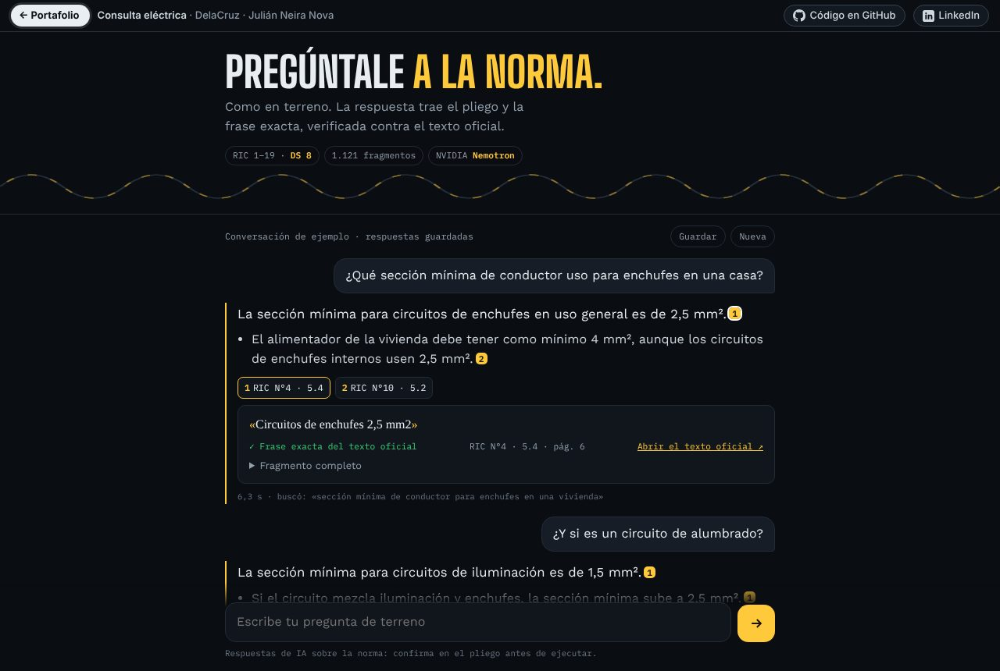
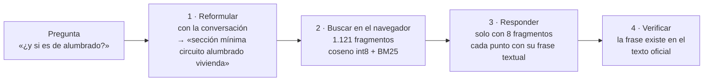

# Consulta eléctrica

**Un chat de normativa eléctrica chilena. Preguntas como en terreno, sigues la conversación ("¿y si es de alumbrado?") y cada respuesta trae el pliego RIC o el artículo del DS 8 con la frase exacta, comparada letra por letra con el texto oficial.**

## Por qué existe

[Consulta RIC](https://github.com/JSNN15/normativa), la primera versión, era un buscador muy bueno: pregunta, fragmentos, respuesta. Pero en terreno uno no hace una pregunta, hace tres seguidas, y la segunda depende de la primera. Y una cita que dice "RIC N°4" no basta: hay que ver la frase.

## Cómo funciona

1. **Reformular.** Nemotron Super convierte la pregunta en una consulta autónoma usando las últimas tres vueltas de la conversación. Si no trata de normativa eléctrica, lo dice sin buscar.
2. **Buscar.** La consulta se vectoriza con Nemotron Embed y se compara en el navegador con los 1.095 fragmentos de los pliegos RIC 1 a 19 y los 26 del DS 8/2019, más búsqueda por palabras, fusionadas por rango recíproco.
3. **Responder.** El modelo recibe solo los 8 fragmentos más cercanos. Responde en uno a cuatro puntos y **cada punto trae obligatoriamente el número del fragmento y una copia textual** de la frase que lo respalda (esquema JSON estricto). El campo "no hay respaldo" va al final del esquema: el modelo primero intenta citar y recién después decide si faltó información. Con ese campo al principio, contestaba "no encontré" a preguntas que sí tenían respuesta.
4. **Verificar.** El navegador busca la frase citada, letra por letra, en el fragmento oficial. Muestra **✓ frase exacta**, **≈ coincide con una tabla** (el PDF desordena las columnas) o **✗ no se pudo verificar**. Cada cita abre el PDF de la SEC en la página o el artículo en LeyChile.

La conversación se puede descargar con sus citas.

## Evaluación

12 preguntas de maestro eléctrico ([detalle](evaluacion.md)): las 12 con respuesta citada; de 29 citas, 25 con frase exacta, 3 que coinciden con tablas y 1 sin verificar. La verificación prueba que la cita existe, no que la respuesta sea la correcta: esa revisión, pregunta por pregunta, está pendiente con un instalador autorizado.

## Límites

- Solo instalaciones de consumo: pliegos RIC y DS 8. No están la generación distribuida (Ley 21.118), el DS 109 ni los oficios de interpretación de la SEC.
- Las tablas de los PDF se extraen desordenadas; por eso existe el estado "coincide con una tabla".
- Es una ayuda de consulta. La responsabilidad del proyecto y la ejecución es del instalador autorizado.

## Archivos

| Archivo | Qué es |
|---|---|
| `index.html` | Chat, búsqueda híbrida, verificación de citas y exportación. |
| `samples.js` | Conversación de ejemplo con respuestas guardadas. |
| `s/ds8.json`, `s/vec.bin` | DS 8/2019 por artículo con enlace a LeyChile, y sus vectores int8. Los pliegos RIC se leen del índice de [normativa](https://github.com/JSNN15/normativa). |
| `tools/descargar.sh`, `tools/chunk.py`, `tools/embed.py` | Descarga el DS 8 desde LeyChile, lo corta por artículo y lo vectoriza (necesita `NVIDIA_API_KEY`). |
| `tools/evaluar.py`, `tools/preguntas.json` | Corre las 12 preguntas por el flujo completo y cuenta cuántas citas existen en el texto oficial. Así se obtuvo `evaluacion.md`. |

Las llamadas a NVIDIA pasan por [nv-gateway](https://github.com/JSNN15/nv-gateway) (`/reformula`, `/embed`, `/responde`); la clave no llega al navegador.

## Fuentes

- [Pliegos técnicos RIC N°1 a 19](https://www.sec.cl/reglamento-de-seguridad-de-las-instalaciones-de-consumo-de-energia-electrica-decreto-08/), Superintendencia de Electricidad y Combustibles.
- [DS 8/2019, Reglamento de seguridad de las instalaciones de consumo de energía eléctrica](https://www.bcn.cl/leychile/navegar?idNorma=1143069), LeyChile.

---

Servicio y Soluciones Tecnológicas DelaCruz SpA · [Julián Neira Nova](https://www.linkedin.com/in/julian-neira-nova/) · [Portafolio](https://jsnn15.github.io/)
