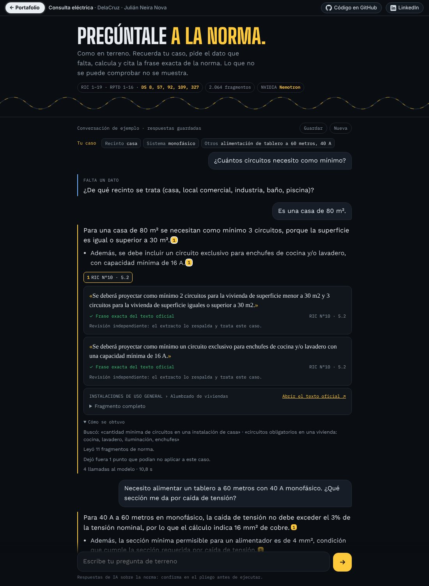
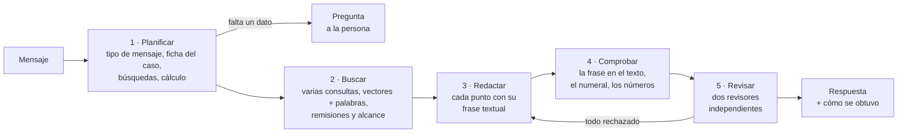

# Consulta eléctrica

**Asistente de normativa eléctrica chilena. Recuerda el caso, pide el dato que falta, calcula por código y responde con la frase de la norma. Un punto se muestra solo si su cita está en el texto oficial y pasa una revisión independiente.**

## Qué hace en cada turno

1. **Planificar.** Clasifica el mensaje (pregunta, dato del caso, aclaración, cálculo, resumen, fuera de tema), actualiza la ficha del caso (recinto, sistema, tensión, potencia) y escribe hasta tres búsquedas con el vocabulario de la norma. Si la respuesta depende de un dato que no tiene, lo pide y guarda la pregunta.
2. **Buscar.** 2.064 fragmentos, en el navegador: similitud de vectores más palabras, cada búsqueda con cupos asegurados. Sigue las remisiones ("según la sección 6 del RIC N°11") y agrega el artículo de alcance de la norma dominante.
3. **Redactar.** Uno a cuatro puntos; cada uno con el número del fragmento y una copia textual de la frase que lo respalda.
4. **Comprobar, sin modelo.** La frase se busca en el fragmento citado y en los demás del turno; lo que se muestra es el texto oficial, no lo que escribió el modelo. Un punto cuya frase no aparece no se muestra. El numeral se muestra solo si está escrito en el fragmento. Los números que no están en el extracto ni en el cálculo se marcan.
5. **Revisar.** Un revisor ve la pregunta y dice si el extracto respalda el punto y si trata la misma situación. Otro, sin ver la pregunta, dice si el extracto da el dato como regla o como condición de una excepción. Si rechazan todo, se redacta una vez más con el motivo; si vuelve a fallar, la respuesta es "no encontré respaldo".

Los cálculos (corriente, caída de tensión) los hace el código con los datos que dio la persona; lo que se supone se declara. Cada respuesta trae "cómo se obtuvo": qué buscó, cuántos fragmentos leyó y qué puntos descartó y por qué.

## Normas cargadas

| Norma | Materia | Fragmentos |
|---|---|---|
| Pliegos RIC N°1 a 19 | Instalaciones de consumo | 1.095 |
| DS 8/2019 | Reglamento de instalaciones de consumo | 26 |
| Pliegos RPTD N°1 a 16 | Líneas, redes y subestaciones | 417 |
| DS 109/2017 | Reglamento de seguridad de instalaciones de producción, transporte y distribución | 22 |
| DS 92/1983 | Instaladores eléctricos y sus clases | 26 |
| DS 57/2019 | Generación distribuida para autoconsumo | 108 |
| DS 327/1997 | Reglamento de la Ley General de Servicios Eléctricos | 370 |

## Validación

[evaluacion.md](evaluacion.md) tiene el detalle y lo que salió mal.

- **Conversaciones**, en tres corridas seguidas: 19 a 20 de 20 turnos en el set reservado y 38 a 40 de 42 en el de desarrollo. El resultado cambia de una corrida a otra; por eso va como rango. Las 9 preguntas que están fuera de las normas se rechazaron en las tres. Mediana de 9 a 10 segundos por turno.
- **Lectura a mano del set reservado**: 16 respuestas correctas, 3 incompletas y 1 incorrecta que las pruebas automáticas no detectaron.
- **El revisor**, con respuestas que llevan un error plantado: bloquea 17 de 18 en el set reservado y no bota ninguna de las 14 correctas.

No reemplaza la revisión de un instalador autorizado.

## Límites

- No están el RPTD N°17, las instrucciones técnicas RGR, los oficios de la SEC ni las normas NCh.
- Solo texto: no lee fotos ni planos. Recuerda lo conversado mientras la página está abierta; al recargar parte de cero.
- El revisor a veces bota un punto correcto y la respuesta queda incompleta. Pasó en 1 de 8 corridas de la pregunta por la clase D (ver [evaluacion.md](evaluacion.md)).
- «Explícamelo en simple» comprueba que no aparezcan números nuevos, no que el sentido sea idéntico. Vale la respuesta con citas.
- El texto de las tablas sale desordenado de los PDF.
- La clave de prueba de NVIDIA admite pocas consultas por minuto, compartidas entre todas las demos.

## Archivos

| Archivo | Qué es |
|---|---|
| `index.html` | La página: conversación, ficha del caso, citas, cálculo y traza. |
| `motor.js` | El agente. Lo usan igual la página y el evaluador. |
| `s/corpus.json`, `s/corpus.bin` | Fragmentos con norma, numerales, materia, ámbito y enlace; vectores int8 de 512 dimensiones. |
| `s/t/*.json` | El mismo texto en tramos de 256 fragmentos, para el intermediario. |
| `samples.js` | La conversación de ejemplo, generada con `eval/muestra.mjs`. |
| `eval/evaluar.mjs`, `eval/desarrollo.json`, `eval/reservado.json` | Conversaciones de prueba y su evaluador. |
| `eval/revisor.mjs`, `eval/revisor.json`, `eval/revisor_reservado.json` | Respuestas correctas y con error plantado para medir al revisor. |
| `eval/*.res.json` | Resultados de las corridas publicadas. |
| `eval/tres.sh`, `eval/tres/` | Los dos sets corridos tres veces seguidas y sus resultados. |
| `eval/simple.mjs`, `eval/simple.res.json` | Prueba de «Explícamelo en simple» con ocho respuestas reales. |
| `eval/busca.mjs` | Muestra qué fragmentos llegan al redactor para una consulta. |
| `tools/build_corpus.py`, `tools/embed_corpus.py`, `tools/unir_corpus.py` | Fragmentan los RPTD (PDF de la SEC) y los decretos (XML de LeyChile), los vectorizan (`NVIDIA_API_KEY`) y arman el corpus junto al índice RIC de [normativa](https://github.com/JSNN15/normativa). |
| `tools/cobertura_ric.py` | Mide cuánto del texto de cada PDF quedó en el corpus. |
| `tools/fuentes.txt` | Direcciones de los documentos oficiales. |

Las llamadas al modelo pasan por [nv-gateway](https://github.com/JSNN15/nv-gateway) (`/plan`, `/embed`, `/redacta`, `/juez`). La página envía números de fragmento; el texto de la norma lo pone el servidor.

## Fuentes

- [Pliegos técnicos RIC](https://www.sec.cl/reglamento-de-seguridad-de-las-instalaciones-de-consumo-de-energia-electrica-decreto-08/) y [pliegos técnicos RPTD](https://www.sec.cl/decreto-n109-aprueba-reglamento-de-seguridad-de-las-instalaciones-electricas/), Superintendencia de Electricidad y Combustibles.
- Decretos [8/2019](https://www.bcn.cl/leychile/navegar?idNorma=1143069), [109/2017](https://www.bcn.cl/leychile/navegar?idNorma=1119451), [92/1983](https://www.bcn.cl/leychile/navegar?idNorma=9058), [57/2019](https://www.bcn.cl/leychile/navegar?idNorma=1149788) y [327/1997](https://www.bcn.cl/leychile/navegar?idNorma=124102), LeyChile.

---

Servicio y Soluciones Tecnológicas DelaCruz SpA · [Julián Neira Nova](https://www.linkedin.com/in/julian-neira-nova/) · [Portafolio](https://jsnn15.github.io/)
